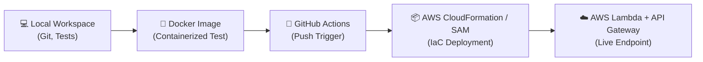

# 🚀 Git & DevOps W2: End-to-End Containerized CI/CD & AWS Serverless Deployment

> **Notion Note Tag:** `#DevOps #Git #Docker #GitHubActions #AWS #CloudFormation #SAM`  
> **Course Module:** Week 2 — Automated Testing, Containerization & Serverless Delivery  
> **Objective:** Build a Python calculator, containerize it with Docker, test it automatically via GitHub Actions on push, and deploy serverless infrastructure to AWS using SAM/CloudFormation.

---

## 📌 Executive Summary & Architecture

This guide provides a comprehensive step-by-step walkthrough for building a production-ready CI/CD delivery pipeline for a serverless Python calculator application.



---

## 📑 Table of Contents
1. [Prerequisites & Development Environment](#1-prerequisites--development-environment)
2. [Step 1: Python 3 Calculator Application](#step-1-python-3-calculator-application)
3. [Step 2: Automated Unit Testing Suite](#step-2-automated-unit-testing-suite)
4. [Step 3: Docker Containerization](#step-3-docker-containerization)
5. [Step 4: AWS Infrastructure as Code (CloudFormation & SAM)](#step-4-aws-infrastructure-as-code-cloudformation--sam)
6. [Step 5: GitHub Actions CI/CD Pipeline (Automated on Push)](#step-5-github-actions-cicd-pipeline-automated-on-push)
7. [Step 6: Live Deployment & Panel Verification Demo](#step-6-live-deployment--panel-verification-demo)
8. [Troubleshooting & Common Pitfalls](#troubleshooting--common-pitfalls)

---

## 1. Prerequisites & Development Environment

Before beginning, ensure the following core tools are installed:

| Tool | Recommended Version | Purpose |
| :--- | :--- | :--- |
| **Python** | `3.11+` | Application runtime & `unittest` execution |
| **Git** | `2.x+` | Distributed version control & commit tracking |
| **Docker** | `24+` / Desktop | Environment isolation & containerized testing |
| **AWS CLI & SAM CLI** | Latest | Serverless infrastructure deployment & validation |

> 💡 **Tip:** Standard library `unittest` requires no external pip packages (`requirements.txt`), keeping student environments lightweight and clean.

---

## Step 1: Python 3 Calculator Application

### Objectives:
- Implement pure functions: `add`, `subtract`, and `multiply`.
- Strictly enforce positive integers ($> 0$).
- Reject zero, negative numbers, floats, strings, and booleans with descriptive `ValueError` messages.
- Provide a simple command-line interface.

### Implementation: `calculator.py`
```python
"""
Minimal Python 3.x Calculator Module.
Supports add, subtract, and multiply for positive integers (> 0).
"""
import sys


def validate_positive_integer(value, name="Input"):
    """Validates that a value is a strictly positive integer (> 0)."""
    if not isinstance(value, int) or isinstance(value, bool):
        raise ValueError(f"{name} must be an integer, got {type(value).__name__}.")
    if value <= 0:
        raise ValueError(f"{name} must be a positive integer (> 0), got {value}.")
    return value


def add(a: int, b: int) -> int:
    """Adds two positive integers."""
    validate_positive_integer(a, "Argument 'a'")
    validate_positive_integer(b, "Argument 'b'")
    return a + b


def subtract(a: int, b: int) -> int:
    """Subtracts positive integer b from positive integer a."""
    validate_positive_integer(a, "Argument 'a'")
    validate_positive_integer(b, "Argument 'b'")
    return a - b


def multiply(a: int, b: int) -> int:
    """Multiplies two positive integers."""
    validate_positive_integer(a, "Argument 'a'")
    validate_positive_integer(b, "Argument 'b'")
    return a * b


def main():
    if len(sys.argv) < 4:
        print("Usage: python calculator.py <add|subtract|multiply> <a> <b>")
        sys.exit(1)

    op, a_str, b_str = sys.argv[1], sys.argv[2], sys.argv[3]
    try:
        a = int(a_str)
        b = int(b_str)
    except ValueError:
        print("Error: Operands must be integers.")
        sys.exit(1)

    operations = {"add": add, "subtract": subtract, "multiply": multiply}
    if op not in operations:
        print(f"Error: Unknown operation '{op}'. Supported: add, subtract, multiply")
        sys.exit(1)

    try:
        result = operations[op](a, b)
        print(f"Result: {result}")
    except ValueError as err:
        print(f"Validation Error: {err}")
        sys.exit(1)


if __name__ == "__main__":
    main()
```

### Quick Verification
```bash
python calculator.py add 15 25
# Output: Result: 40

python calculator.py multiply -5 2
# Output: Validation Error: Argument 'a' must be a positive integer (> 0), got -5.
```

---

## Step 2: Automated Unit Testing Suite

### Objectives:
- Validate arithmetic operations against expected outputs.
- Test boundary conditions (e.g. `0` and negative values).
- Test type-safety (e.g. `True`, `3.14`, `"abc"`).
- Test AWS Lambda handler invocation scenarios.

### Implementation: `test_calculator.py`
```python
"""
Unit tests for the Calculator app and Lambda handler.
"""
import json
import unittest
from calculator import add, subtract, multiply
from lambda_function import lambda_handler


class TestCalculator(unittest.TestCase):

    def test_add_success(self):
        self.assertEqual(add(10, 5), 15)
        self.assertEqual(add(1, 1), 2)
        self.assertEqual(add(999, 1), 1000)

    def test_subtract_success(self):
        self.assertEqual(subtract(10, 5), 5)
        self.assertEqual(subtract(5, 10), -5)
        self.assertEqual(subtract(7, 7), 0)

    def test_multiply_success(self):
        self.assertEqual(multiply(6, 7), 42)
        self.assertEqual(multiply(1, 100), 100)
        self.assertEqual(multiply(12, 12), 144)

    def test_zero_input_raises_error(self):
        with self.assertRaises(ValueError):
            add(0, 5)
        with self.assertRaises(ValueError):
            subtract(5, 0)
        with self.assertRaises(ValueError):
            multiply(0, 0)

    def test_negative_input_raises_error(self):
        with self.assertRaises(ValueError):
            add(-1, 5)
        with self.assertRaises(ValueError):
            subtract(10, -3)
        with self.assertRaises(ValueError):
            multiply(-4, -2)

    def test_invalid_types_raise_error(self):
        with self.assertRaises(ValueError):
            add(2.5, 3)
        with self.assertRaises(ValueError):
            subtract("5", 2)
        with self.assertRaises(ValueError):
            multiply(True, 4)


class TestLambdaHandler(unittest.TestCase):

    def test_lambda_query_params_success(self):
        event = {"queryStringParameters": {"operation": "add", "a": "20", "b": "30"}}
        response = lambda_handler(event)
        self.assertEqual(response["statusCode"], 200)
        body = json.loads(response["body"])
        self.assertEqual(body["result"], 50)

    def test_lambda_json_body_success(self):
        event = {"body": json.dumps({"operation": "multiply", "a": 4, "b": 6})}
        response = lambda_handler(event)
        self.assertEqual(response["statusCode"], 200)
        body = json.loads(response["body"])
        self.assertEqual(body["result"], 24)

    def test_lambda_invalid_operation(self):
        event = {"queryStringParameters": {"operation": "divide", "a": "10", "b": "2"}}
        response = lambda_handler(event)
        self.assertEqual(response["statusCode"], 400)

    def test_lambda_negative_number_validation(self):
        event = {"queryStringParameters": {"operation": "add", "a": "-5", "b": "10"}}
        response = lambda_handler(event)
        self.assertEqual(response["statusCode"], 400)


if __name__ == "__main__":
    unittest.main()
```

### Running Tests Locally
```bash
python -m unittest test_calculator.py -v
```

---

## Step 3: Docker Containerization

Containerization ensures identical test execution across local workstations, staging machines, and GitHub Actions runners.

### Implementation: `Dockerfile`
```dockerfile
FROM python:3.11-slim

WORKDIR /app

# Copy application and test files
COPY calculator.py test_calculator.py lambda_function.py ./

# Default entrypoint runs full unit test suite
CMD ["python", "-m", "unittest", "test_calculator.py", "-v"]
```

### Container Commands
```bash
# 1. Build the Docker container image
docker build -t calculator-app:latest .

# 2. Run the tests in an isolated ephemeral container
docker run --rm calculator-app:latest
```

---

## Step 4: AWS Infrastructure as Code (CloudFormation & SAM)

AWS Serverless Application Model (SAM) is an extension of AWS CloudFormation specifically tailored for serverless architectures (Lambda, API Gateway, DynamoDB).

### 1. Lambda Entrypoint: `lambda_function.py`
```python
"""
AWS Lambda Handler for Calculator API.
"""
import json
import calculator


def lambda_handler(event, context=None):
    try:
        params = {}
        if isinstance(event, dict):
            if "queryStringParameters" in event and event["queryStringParameters"]:
                params.update(event["queryStringParameters"])
            elif "body" in event and event["body"]:
                body_data = json.loads(event["body"]) if isinstance(event["body"], str) else event["body"]
                if isinstance(body_data, dict):
                    params.update(body_data)
            else:
                params.update(event)

        op = params.get("operation") or params.get("op")
        a_raw = params.get("a")
        b_raw = params.get("b")

        if not op or a_raw is None or b_raw is None:
            return {
                "statusCode": 400,
                "headers": {"Content-Type": "application/json"},
                "body": json.dumps({"error": "Missing parameters. Required: op (or operation), a, b."})
            }

        a = int(a_raw)
        b = int(b_raw)

        operations = {
            "add": calculator.add,
            "subtract": calculator.subtract,
            "multiply": calculator.multiply,
        }

        if op not in operations:
            return {
                "statusCode": 400,
                "headers": {"Content-Type": "application/json"},
                "body": json.dumps({"error": f"Invalid operation '{op}'. Supported: add, subtract, multiply."})
            }

        result = operations[op](a, b)
        return {
            "statusCode": 200,
            "headers": {"Content-Type": "application/json"},
            "body": json.dumps({"operation": op, "a": a, "b": b, "result": result})
        }
    except ValueError as val_err:
        return {
            "statusCode": 400,
            "headers": {"Content-Type": "application/json"},
            "body": json.dumps({"error": str(val_err)})
        }
    except Exception as exc:
        return {
            "statusCode": 500,
            "headers": {"Content-Type": "application/json"},
            "body": json.dumps({"error": f"Internal Server Error: {str(exc)}"})
        }
```

### 2. SAM / CloudFormation Template: `template.yaml`
```yaml
AWSTemplateFormatVersion: '2010-09-09'
Transform: AWS::Serverless-2016-10-31
Description: AWS CloudFormation SAM template for Python Calculator Application

Globals:
  Function:
    Timeout: 10
    MemorySize: 128
    Runtime: python3.11

Resources:
  CalculatorFunction:
    Type: AWS::Serverless::Function
    Properties:
      CodeUri: ./
      Handler: lambda_function.lambda_handler
      Description: Executes calculator operations (add, subtract, multiply) for positive integers.
      Events:
        GetCalculate:
          Type: Api
          Properties:
            Path: /calculate
            Method: GET
        PostCalculate:
          Type: Api
          Properties:
            Path: /calculate
            Method: POST

Outputs:
  CalculatorApiUrl:
    Description: API Gateway endpoint URL for Calculator
    Value: !Sub "https://${ServerlessRestApi}.execute-api.${AWS::Region}.amazonaws.com/Prod/calculate"
  CalculatorFunctionArn:
    Description: Calculator Lambda Function ARN
    Value: !GetAtt CalculatorFunction.Arn
```

---

## Step 5: GitHub Actions CI/CD Pipeline (Automated on Push)

The workflow file is located at `.github/workflows/ci-cd.yml`. It is triggered automatically when commits are pushed to `main` or `master` branches, eliminating the need for manual webhooks.

```yaml
name: CI-CD Pipeline

on:
  push:
    branches:
      - main
      - master

jobs:
  # =====================================================================
  # 1. CI JOB: Containerized Build & Unit Testing inside Docker
  # =====================================================================
  ci:
    name: CI - Build and Test in Docker
    runs-on: ubuntu-latest
    steps:
      - name: Check out repository
        uses: actions/checkout@v4

      - name: Set up Docker Buildx
        uses: docker/setup-buildx-action@v3

      - name: Build Docker image
        run: |
          docker build -t calculator-app:latest .

      - name: Run unit tests inside Docker container
        run: |
          docker run --rm calculator-app:latest python -m unittest test_calculator.py -v

  # =====================================================================
  # 2. CD JOB: Deploy Serverless Infrastructure to AWS with CloudFormation / SAM
  # =====================================================================
  cd:
    name: CD - Deploy to AWS CloudFormation
    needs: ci
    runs-on: ubuntu-latest
    if: github.ref == 'refs/heads/main' || github.ref == 'refs/heads/master'
    steps:
      - name: Check out repository
        uses: actions/checkout@v4

      - name: Set up AWS SAM CLI
        uses: aws-actions/setup-sam@v2
        with:
          use-installer: true

      - name: Configure AWS Credentials
        uses: aws-actions/configure-aws-credentials@v4
        with:
          aws-access-key-id: ${{ secrets.AWS_ACCESS_KEY_ID }}
          aws-secret-access-key: ${{ secrets.AWS_SECRET_ACCESS_KEY }}
          aws-region: ${{ secrets.AWS_REGION || 'us-east-1' }}

      - name: SAM Build
        run: |
          sam build --use-container

      - name: SAM Deploy to AWS
        run: |
          sam deploy \
            --no-confirm-changeset \
            --no-fail-on-empty-changeset \
            --stack-name calculator-app-prod \
            --capabilities CAPABILITY_IAM \
            --resolve-s3
```

### GitHub Repository Secrets Checklist
Configure under **Repository Settings ➔ Secrets and variables ➔ Actions**:
- [ ] `AWS_ACCESS_KEY_ID`: IAM user access key
- [ ] `AWS_SECRET_ACCESS_KEY`: IAM user secret key
- [ ] `AWS_REGION`: e.g. `us-east-1`

---

## Step 6: Live Deployment & Panel Verification Demo

### 1. Commit and Push to Trigger Pipeline
```bash
git add .
git commit -m "feat: complete calculator app with Docker CI and AWS SAM CD"
git remote add origin https://github.com/<your-username>/<your-repo>.git
git push -u origin main
```

### 2. Verify in GitHub Actions
1. Navigate to the **Actions** tab of the GitHub repository.
2. Watch the **CI - Build and Test in Docker** job build the image and output unit test results.
3. Observe the **CD - Deploy to AWS CloudFormation** job run SAM deploy and provision resources.

### 3. Live Test the AWS Serverless API
Once deployed, retrieve the `CalculatorApiUrl` from CloudFormation outputs or GitHub Actions deployment log:

```bash
# 1. Test Addition (GET query parameter)
curl "https://<api-id>.execute-api.<region>.amazonaws.com/Prod/calculate?op=add&a=15&b=25"
# Response: {"operation": "add", "a": 15, "b": 25, "result": 40}

# 2. Test Multiplication (POST JSON body)
curl -X POST "https://<api-id>.execute-api.<region>.amazonaws.com/Prod/calculate" \
     -H "Content-Type: application/json" \
     -d '{"operation": "multiply", "a": 6, "b": 7}'
# Response: {"operation": "multiply", "a": 6, "b": 7, "result": 42}

# 3. Test Negative Input Validation (Expected 400 Bad Request)
curl "https://<api-id>.execute-api.<region>.amazonaws.com/Prod/calculate?op=subtract&a=-10&b=5"
# Response: {"error": "Argument 'a' must be a positive integer (> 0), got -10."}
```

---

## 🛠️ Troubleshooting & Common Pitfalls

| Issue | Root Cause | Solution |
| :--- | :--- | :--- |
| **`ValueError: ... must be an integer, got bool`** | In Python, `bool` is a subclass of `int` (`isinstance(True, int) == True`). | Added explicit `not isinstance(value, bool)` validation check in `validate_positive_integer`. |
| **Docker daemon connection error on local machine** | Docker Desktop engine is stopped or not running as administrator. | Start Docker Desktop or rely on GitHub Actions runner where Docker is pre-configured. |
| **`sam deploy` fails with `Unable to locate credentials`** | GitHub repository secrets missing or misspelled. | Verify `AWS_ACCESS_KEY_ID` and `AWS_SECRET_ACCESS_KEY` in GitHub Repository Secrets. |
| **CloudFormation `CAPABILITY_IAM` required** | SAM creates an execution IAM role for Lambda automatically. | Ensure `--capabilities CAPABILITY_IAM` is passed in `sam deploy`. |

---

## 🧹 Post-Demo Infrastructure Cleanup
To avoid ongoing AWS charges after the demonstration:
```bash
sam delete --stack-name calculator-app-prod --no-prompts
```
