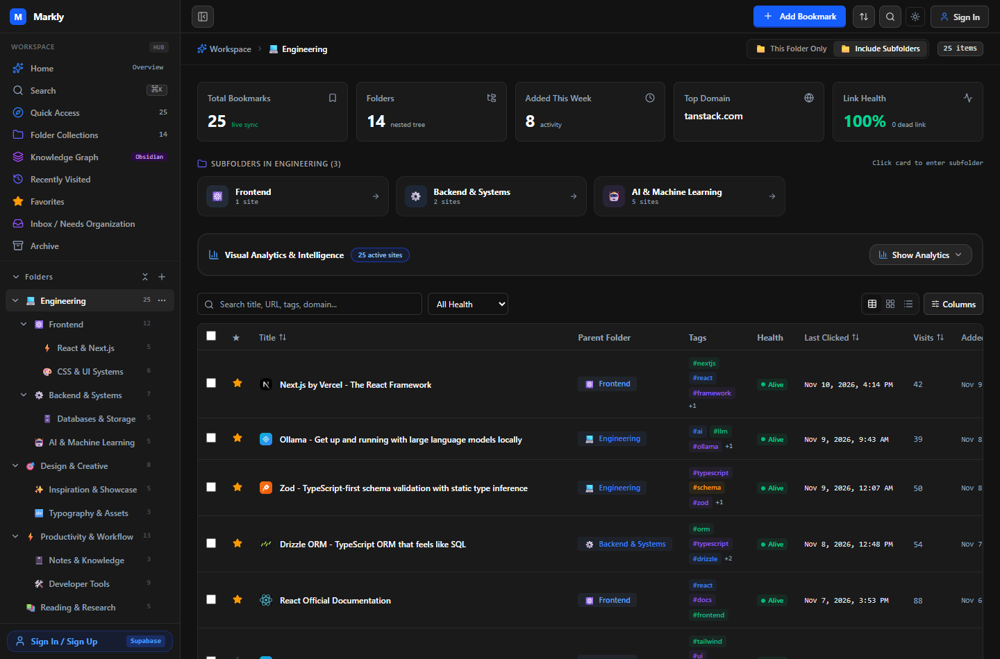
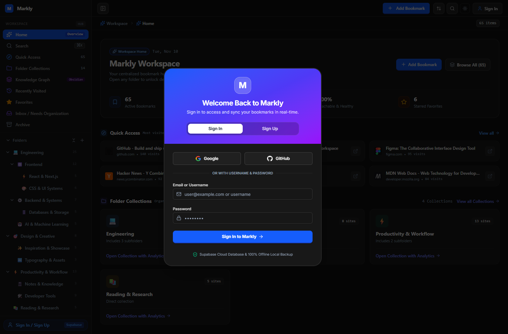
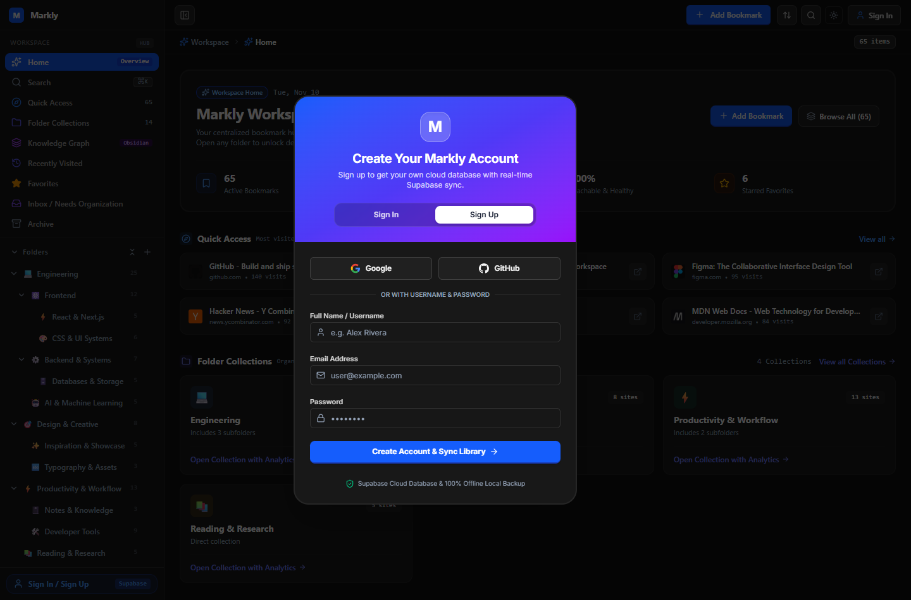
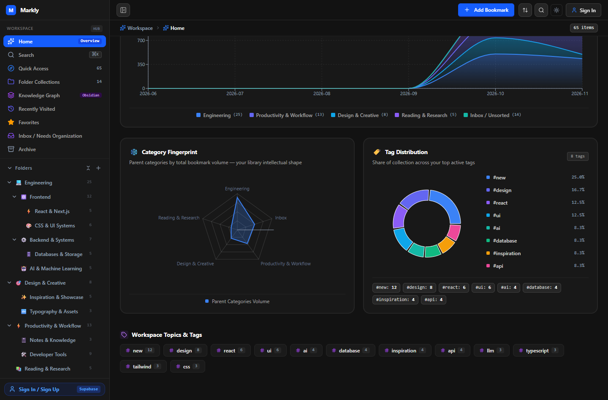
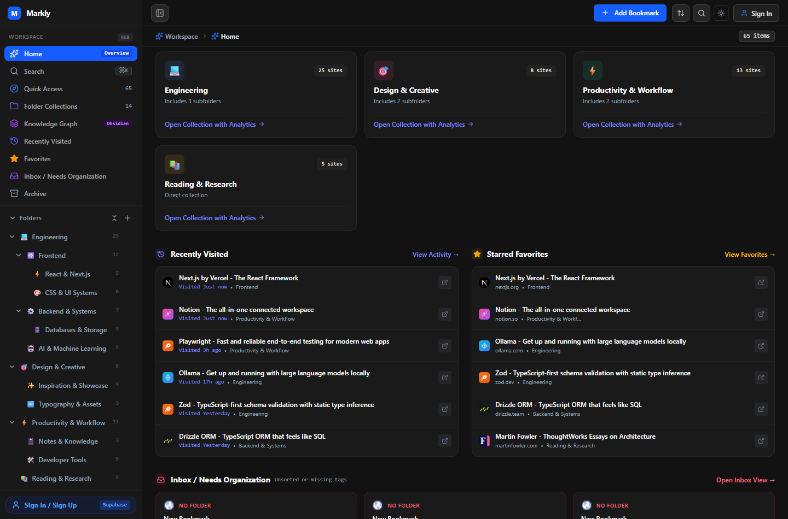
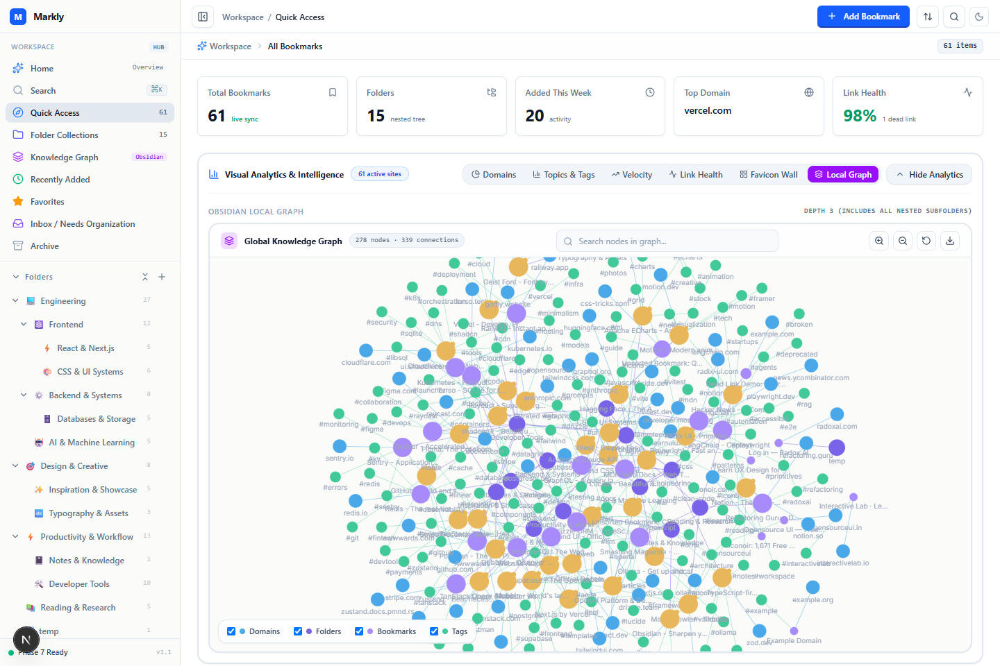
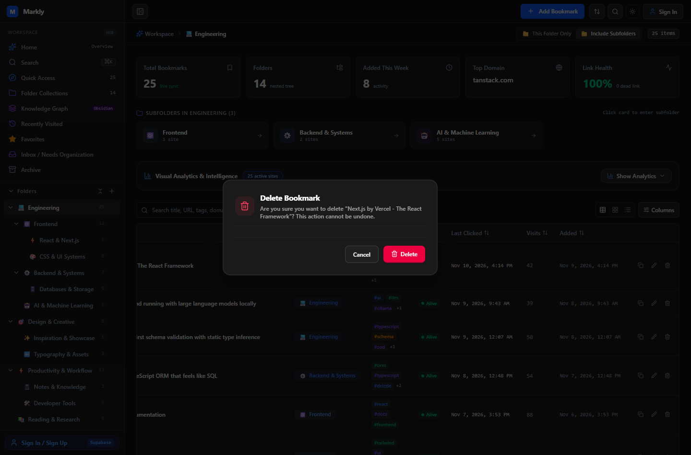

<div align="center">

# 🔖 Markly

### *The Intelligent Visual Bookmark Manager & Personal Knowledge Workspace*

[](https://nextjs.org/)
[](https://react.dev/)
[](https://supabase.com/)
[](https://www.postgresql.org/)
[](https://tailwindcss.com/)
[](https://www.typescriptlang.org/)

<p align="center">
  A privacy-first, cloud-synchronized bookmark operating system featuring interactive local knowledge graphs, real-time visit telemetry, dynamic forgotten bookmarks timelines, and comprehensive visual analytics.
</p>

---



</div>

---

## 📑 Table of Contents

- [Overview](#-overview)
- [Key Features & Visual Tour](#-key-features--visual-tour)
  - [1. Universal Supabase Auth & Realtime Sync](#1-universal-supabase-auth--realtime-sync)
  - [2. Deep Visual Analytics Suite](#2-deep-visual-analytics-suite)
  - [3. Forgotten Bookmarks Timeline](#3-forgotten-bookmarks-timeline)
  - [4. Nested Folders & Segmented Filter Control](#4-nested-folders--segmented-filter-control)
  - [5. Obsidian-Style Knowledge Graph](#5-obsidian-style-knowledge-graph)
  - [6. Destructive Actions Safety Modal](#6-destructive-actions-safety-modal)
- [Architecture & Tech Stack](#-architecture--tech-stack)
- [Security Hardening](#-security-hardening)
- [Replication & Setup Guide](#-replication--setup-guide)
- [Repository Structure](#-repository-structure)

---

## 🌟 Overview

Modern bookmark managers often become digital graveyards where links are saved once and forgotten forever. **Markly** reinvents link management by combining **hierarchical folder organization**, **force-directed knowledge graphs**, and **live usage telemetry** to ensure your knowledge library remains vibrant, accessible, and insightful.

All your links, nested collections, and tags synchronize instantaneously across sessions and devices using **Supabase PostgreSQL** guarded by strict **Row-Level Security (RLS)**.

---

## 📸 Key Features & Visual Tour

### 1. Universal Supabase Auth & Realtime Sync

Seamless multi-tenant authentication powered by Supabase GoTrue. Users can sign in via **Google OAuth**, **GitHub OAuth**, or **Email / Username + Password**.

<div align="center">
  <table>
    <tr>
      <td width="50%" align="center"><b>Sign In Modal</b></td>
      <td width="50%" align="center"><b>Create Account / Sign Up Modal</b></td>
    </tr>
    <tr>
      <td></td>
      <td></td>
    </tr>
  </table>
</div>

- **Instant Migration**: Guest users are automatically prompted on registration to seamlessly migrate their existing local links into their cloud account.
- **Real-Time WebSocket Sync**: Open multiple tabs or devices; changes propagate instantly with zero manual page refreshes.

---

### 2. Deep Visual Analytics Suite

Markly transforms your bookmarks into real-time intellectual insights:

<div align="center">
  
</div>

- **❄️ Category Fingerprint (Radar Chart)**: Maps your library's intellectual shape across your top collections, giving you an immediate fingerprint of your focus areas.
- **🍩 Tag Distribution (Donut Chart)**: Visualizes the proportional volume of active tags with precise percentages and one-click filtering pills.
- **📚 Bookmarking Activity Over Time (Stacked Area)**: Visualizes visit frequency over monthly timeframes, supporting toggles between **Visited Sites** and **Created**.

---

### 3. Forgotten Bookmarks Timeline

*Identify and rediscover dormant links before they decay.*

<div align="center">
  
</div>

- **Dynamic Recency Slider**: Slide anywhere from **1 Day (24-Hour Division)** to **90 Days (Daily Grid Divisions)**.
- **Crisp Interactive Dots**: Each dot represents an exact website. Hovering over any dot displays a rich tooltip with the domain, parent collection, total visit count, and exact timestamp of when it was last clicked.
- **`Last Clicked` Telemetry**: Every bookmark row displays an updated `Last Clicked` column adjacent to link health status.

---

### 4. Nested Folders & Segmented Filter Control

Manage complex bookmark hierarchies effortlessly with infinite subfolder nesting and instant breadcrumb navigation.

<div align="center">
  
</div>

- **Segmented Subfolder Capsule**: Switch effortlessly between:
  ```
  [ 📁 This Folder Only ] [ 📁 Include Subfolders ]
  ```
- **Visual Subfolder Cards**: Clickable overview cards preview child folder counts and health metrics.
- **Live Link Health Checker**: Real-time status indicators highlight reachable URLs and detect broken links.

---

### 5. Obsidian-Style Knowledge Graph

Explore the intellectual topology of your entire bookmark library through an interactive force-directed graph.

<div align="center">
  
</div>

- **Force-Directed Physics Simulation**: Folders and bookmarks act as interconnected nodes.
- **Local & Nested Modes**: Zoom in on specific parent folders to inspect localized relationship clusters.
- **Customizable Controls**: Adjust node repulsion, link distance, collision radii, and label visibility in real time.

---

### 6. Destructive Actions Safety Modal

To prevent accidental deletions, all native browser `confirm()` prompts have been replaced with centered, high-contrast confirmation dialogs:

<div align="center">
  
</div>

- **Centered Viewport Placement**: Ensures notifications are never obscured beneath address bars.
- **Clear Intent Feedback**: Displays exact bookmark or folder titles with an explicit destructive confirmation button.

---

## 🛠️ Architecture & Tech Stack

| Layer | Technologies |
| :--- | :--- |
| **Frontend Framework** | [Next.js 16.4.5](https://nextjs.org/) (App Router, Turbopack, React Server Components) |
| **UI Library** | [React 19](https://react.dev/), [Tailwind CSS 4](https://tailwindcss.com/), Radix UI Primitives, Lucide Icons |
| **Smart Skeletons** | [Skullet 🦴](https://skullet.lochie.me/) (Adaptive layout-shift-free skeletons, measure-first loading animations) |
| **Database & Auth** | [Supabase](https://supabase.com/) (PostgreSQL 15+, GoTrue Auth, Realtime Replication Channels) + [SQLite](https://github.com/WiseLibs/better-sqlite3) (Fast WAL local store) |
| **AI Integration** | [Google Gemini AI](https://ai.google.dev/) (Intelligent categorization, tag generation & descriptions with daily quota management) |
| **Data Visualizations** | [Recharts](https://recharts.org/), [React Force Graph 2D](https://github.com/vasturiano/react-force-graph), [Graphology](https://graphology.github.io/) |
| **Security & Utilities** | `ipaddr.js` (Strict SSRF Guard), `cheerio` (Safe Metadata Extraction), `sharp` (64x64 WebP Favicon Processing), `zod` |

---

## 🛡️ Security Hardening

- **Session-Based Authentication Only**: Caller identity is resolved strictly via verified Supabase sessions (`supabase.auth.getUser()`). Identity is never accepted from query parameters, request bodies, or custom client cookies.
- **Client-Side AI Keys Only**: AI API keys (such as Google Gemini) are stored strictly in the browser (`localStorage`) and sent per-request via the `x-ai-config` header. AI keys are never persisted in the database, never logged, and never stored on or returned by the server.
- **Daily Free AI Quota**: Provides 30 free AI enrichments per calendar day for all users, tracking daily usage in the user profile. If quota is exceeded, bookmark creation continues smoothly without interruption, with an instant option to plug in a personal free Gemini key for unlimited enrichments.
- **SSRF Mitigation**: Outbound scraping and health check requests strictly validate every hop (including redirects up to 3 hops with `redirect: "manual"`). Target domains and IP addresses are resolved and blocked if they match loopback (`127.0.0.0/8`, `::1`), private subnets (`10.0.0.0/8`, `172.16.0.0/12`, `192.168.0.0/16`), or Cloud metadata endpoints (`169.254.169.254`).
- **Postgres Row-Level Security (RLS)**: Enforced directly on `profiles`, `folders`, `bookmarks`, `tags`, and `bookmark_tags`. Users cannot query, mutate, or delete data belonging to other tenant UIDs. Cross-tenant access attempts return 404.
- **Sliding-Window Rate Limiting**: Scraper, AI suggest, import, and health check endpoints are rate-limited via a sliding-window tracker scoped to the session user ID or client IP.
- **Strict Security Headers & CSP**: CSP restricting connect-src to `'self'`, Supabase, and Google Gemini API, `X-Frame-Options: DENY`, `X-Content-Type-Options: nosniff`, `Referrer-Policy: strict-origin-when-cross-origin`, and `Permissions-Policy`.
- **Zero Client Credential Leakage**: Only public publishable anon keys are exposed to the browser. Admin service-role keys are strictly server-side.
- **XSS Sanitization**: Cheerio parses third-party HTML strictly as plain text nodes, preventing stored script injection.

---

## ⚡ Replication & Setup Guide

Replicating Markly takes under 5 minutes:

### 1. Clone the repository
```bash
git clone https://github.com/Sasivan/Markly.git
cd Markly/Project-1
```

### 2. Install dependencies
```bash
npm install
```

### 3. Initialize your Supabase Database
1. Create a free project at [supabase.com](https://supabase.com).
2. Run migrations located in `supabase/migrations/` (or connect via `.env.local` for automatic sync).

### 4. Configure Environment Variables
```bash
cp .env.example .env.local
```
Add your Supabase credentials:
```ini
NEXT_PUBLIC_SUPABASE_URL=https://your-project-ref.supabase.co
NEXT_PUBLIC_SUPABASE_ANON_KEY=your-anon-publishable-key
SUPABASE_SERVICE_ROLE_KEY=your-service-role-key
```

### 5. Start the Application
```bash
npm run dev
```
Open **[http://localhost:3000](http://localhost:3000)** in your browser.

### 6. Run Automated Verification & Tests
```bash
npx tsc --noEmit
npx vitest run
```

---

## 📁 Repository Structure

```text
Project-1/
├── app/                               # Next.js 16 App Router & APIs
│   ├── api/
│   │   ├── ai/suggest/                # Gemini AI tags & description suggestion
│   │   ├── auth/                      # Session verification & Supabase sync
│   │   ├── bookmarks/                 # Scoped CRUD, tags & visit telemetry
│   │   ├── folders/                   # Nested collection tree endpoints
│   │   ├── health-check/              # Dead-link checker with status badges
│   │   ├── import/ & export/          # Multi-format HTML, JSON, CSV processing
│   │   ├── recycle-bin/               # Trash retention & restore endpoints
│   │   ├── scrape/                    # SSRF-protected metadata fetcher
│   │   └── user/profile/              # Profile, avatar & username endpoints
│   ├── globals.css                    # Tailwind CSS 4 + Skullet animation styles
│   ├── layout.tsx                     # Root HTML & body structure
│   ├── providers.tsx                  # React Query, Themes & Auth providers
│   └── page.tsx                       # Markly primary workspace container
├── components/                        # High-Performance React Components
│   ├── add-bookmark-modal.tsx         # Modern Add modal (inline folder, paste, AI quota)
│   ├── app-header.tsx                 # Sleek top navbar, quick actions & avatar dropdown
│   ├── auth/                          # Supabase Auth modal, OAuth & context
│   ├── collections/                   # Folder collections directory & quick-add
│   ├── command-palette.tsx            # Fuzzy search across bookmarks & folders (⌘K)
│   ├── folders/                       # Folder management panel & subfolder views
│   ├── graph/                         # Obsidian force-directed knowledge graph
│   ├── home/                          # Workspace home & forgotten bookmarks slider
│   ├── profile/                       # Profile view, AI daily quota & database sync
│   ├── sidebar/                       # Sidebar tree, quick hover '+' actions, collapsible rail
│   ├── table/ & cards/                # Multi-view virtualized bookmark displays
│   ├── trash/                         # PC-Style Recycle Bin with permanent retention
│   └── ui/                            # Skullet smart skeletons, modals, badges, inputs
├── lib/                               # Client & Shared Utilities
│   ├── ai-config.ts                   # Daily quota tracker (30 free/day) & key manager
│   ├── csrf.ts                        # CSRF protection & origin verification
│   ├── rate-limit.ts                  # Sliding-window rate limiting engine
│   └── utils.ts                       # Class merging & text helpers
├── server/                            # Server-Side Core Architecture
│   ├── auth/                          # requireUser session guard & CSRF checks
│   ├── db/                            # SQLite repository & schema definitions
│   ├── scraper/                       # SSRF guard, Cheerio parser & Sharp WebP icon pipeline
│   └── supabase/                      # Supabase client SSR & sync managers
├── supabase/                          # Supabase PostgreSQL Migrations
│   └── migrations/                    # Hardened RLS schemas, search_path & constraints
└── tests/                             # Automated Test Suites
    ├── ai-config.test.ts              # Quota & header injection tests
    ├── auth.test.ts                   # Authentication & permission tests
    ├── import-export.test.ts          # Roundtrip import/export validation
    └── scraper.test.ts                # SSRF blocking & metadata extraction tests
```

---

<div align="center">
  <sub>Built with ❤️ for privacy, clarity, and knowledge organization.</sub>
</div>
