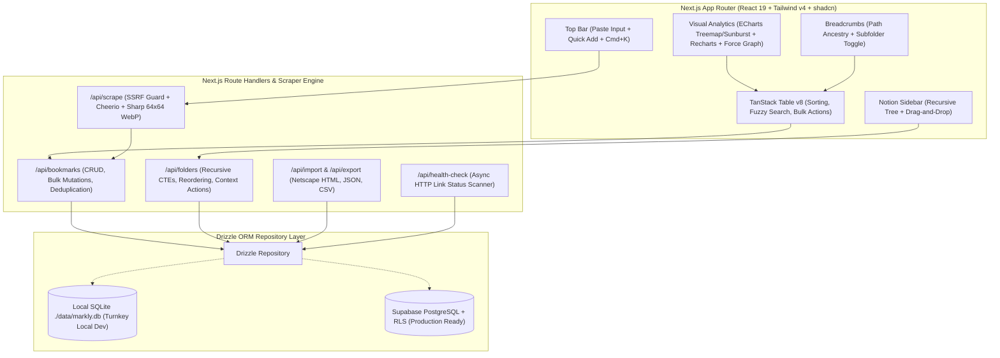

# Markly 🔖 — Notion-Style Bookmark Manager & Visual Analytics

**Markly** is a production-quality, Notion-inspired bookmark manager built for deep organization, visual intelligence, and bookmark health tracking.


---

## 🌟 Key Features

### 1. Paste-to-Add Flow & Scraper Engine
- **Global Link Paste**: Paste any link anywhere on the page (`Ctrl+V` / `Cmd+V`) or via the top input bar.
- **SSRF-Hardened Scraper (`/api/scrape`)**: Strict multi-layer IP protection via `ipaddr.js` blocking localhost, loopback, private ranges, link-local, and cloud metadata (`169.254.169.254`).
- **Safe Fetching**: 8-second timeout, max 2MB payload cap, and manual redirect validation across every hop.
- **6-Tier Icon Waterfall**: Apple touch icon (largest) ➔ standard favicon ➔ Web App manifest ➔ root `/favicon.ico` ➔ Google S2 Favicon API ➔ unique SVG letter avatar.
- **WebP Optimization**: Automatically resizes and converts all scraped favicons to 64x64 WebP format via `sharp`.
- **Duplicate Detection**: Real-time canonical URL deduplication alerting you if a link is already saved and displaying its folder location.

### 2. Notion-Style Recursive Sidebar
- **Unlimited Nesting Depth**: Adjacency list data model powered by recursive SQL CTEs.
- **Drag-and-Drop Organization**: Reorder folders or drag them onto other folders to reparent instantly.
- **Inline Editing & Context Menus**: Double-click to rename inline, customize folder icons & color badges, duplicate, or delete with options (*Move contents up* vs *Delete all*).
- **System Views**: All Bookmarks, Favorites, Recent, Unsorted (Inbox), and Archive.
- **Collapsible & Resizable**: Drag the right border to adjust width (190px–450px) or press `Ctrl+\` to toggle collapse.

### 3. Visual Analytics Dashboard
- **Folder Volume Treemap (Apache ECharts)**: Proportional tiles representing bookmark counts; click to drill down and filter.
- **Nested Sunburst (Apache ECharts)**: Radial concentric visualization of nested folder hierarchies.
- **Activity Calendar Heatmap (Apache ECharts)**: GitHub-style 365-day calendar grid tracking additions over time.
- **Domain & Tag Breakdown (Recharts)**: Interactive donut and horizontal bar charts with slice click-to-filter support.
- **Force-Directed Graph (`react-force-graph-2d`)**: Physics simulation connecting folder hubs to bookmark leaf nodes.
- **Favicon Wall**: Visual gallery displaying scraped high-resolution favicons.

### 4. Advanced TanStack Table v8
- **Power Views**: One-click switcher between **Table View**, **Cards / Gallery View**, and **Compact List View**.
- **Multi-Column Sorting**: Shift-click column headers to sort across multiple fields.
- **Global Fuzzy Search**: Search instantly across titles, URLs, descriptions, domains, and tags.
- **Link Health Filter**: Filter between `All Health`, `🟢 Alive`, and `🔴 Dead Links`.
- **Column Visibility Toggles**: Customize visible columns.
- **Floating Bulk Action Toolbar**: Select multiple bookmarks to move, tag, favorite, archive, export, or delete in bulk.

### 5. Portability & Health Tracking
- **Import & Export**:
  - Netscape Bookmark HTML format (compatible with Chrome, Arc, Safari, Firefox, Edge).
  - JSON and CSV export/import.
- **Background Health Check**: Scans bookmarks with fast HEAD/GET requests and flags dead/404 links.
- **Keyboard Shortcuts**:
  - `Ctrl+K` / `Cmd+K`: Command palette.
  - `Ctrl+V` / `Cmd+V`: Global link paste.
  - `N`: Quick-add bookmark modal.
  - `/`: Focus search input.
  - `G` then `F`: Go to Favorites.
  - `G` then `A`: Go to All Bookmarks.
  - `Ctrl+\`: Toggle sidebar collapse.

---

## 🏛️ Architecture Diagram



---

## 📦 Pinned Package Versions

| Package | Version | Purpose |
| :--- | :--- | :--- |
| `next` | `16.4.5` | React Server Components, App Router, Route Handlers |
| `react` & `react-dom` | `19.3.1` | React 19 core primitives |
| `tailwindcss` | `^4.0.12` | CSS-first theming with Notion color tokens |
| `drizzle-orm` | `^0.45.4` | Relational query builder and migrations |
| `better-sqlite3` | `^13.0.3` | Zero-config synchronous SQLite driver |
| `@tanstack/react-table` | `^8.21.2` | Headless table engine with sorting, filters, and selection |
| `echarts` & `echarts-for-react` | `^6.1.0` / `^3.0.6` | Treemap, Sunburst, and Activity Heatmap |
| `recharts` | `^3.2.0` | Domain donut and tag horizontal bar charts |
| `react-force-graph-2d` | `^1.29.2` | Force-directed physics network simulation |
| `cheerio` | `^1.2.0` | Server-side HTML metadata extraction |
| `sharp` | `^0.35.5` | High-performance WebP conversion (64x64) |
| `ipaddr.js` | `^2.5.0` | Strict SSRF IP parsing and range protection |
| `cmdk` | `^1.1.1` | Notion-style command palette |
| `lucide-react` | `^1.70.0` | Vector icon suite |
| `vitest` | `^3.0.8` | Unit testing framework |
| `@playwright/test` | `^1.51.0` | End-to-end browser integration testing |

---

## 🚀 Getting Started

### 1. Prerequisites
- Node.js `20.x` or later (tested on Node `24.19.0`)
- npm or pnpm

### 2. Installation
```bash
git clone <repo-url>
cd Markly
npm install
```

### 3. Environment Variables
Copy `.env.example` to `.env.local`:
```bash
cp .env.example .env.local
```

Default contents (zero-config SQLite):
```env
DATABASE_MODE=sqlite
DATABASE_SQLITE_PATH=./data/markly.db
NEXT_PUBLIC_APP_URL=http://localhost:3000
NODE_ENV=development
```

*(Optional Supabase setup for PostgreSQL):*
```env
DATABASE_URL=postgresql://postgres:[PASSWORD]@[HOST]:5432/postgres
NEXT_PUBLIC_SUPABASE_URL=https://your-project.supabase.co
NEXT_PUBLIC_SUPABASE_ANON_KEY=your-anon-key
```

### 4. Seed the Database
Populate 14 nested folders across 3 hierarchy levels and 55+ realistic bookmarks:
```bash
npm run db:seed
```

### 5. Start Development Server
```bash
npm run dev
```
Open [http://localhost:3000](http://localhost:3000) in your browser.

---

## 🧪 Testing

### Run Vitest Unit Tests
Tests SSRF protection, URL normalizer, Netscape HTML parser/generator, and CSV converter:
```bash
npm test
```

### Run Playwright E2E Tests
Runs automated browser tests against the live application:
```bash
npx playwright test
```

### Production Build
```bash
npm run build
npm start
```

